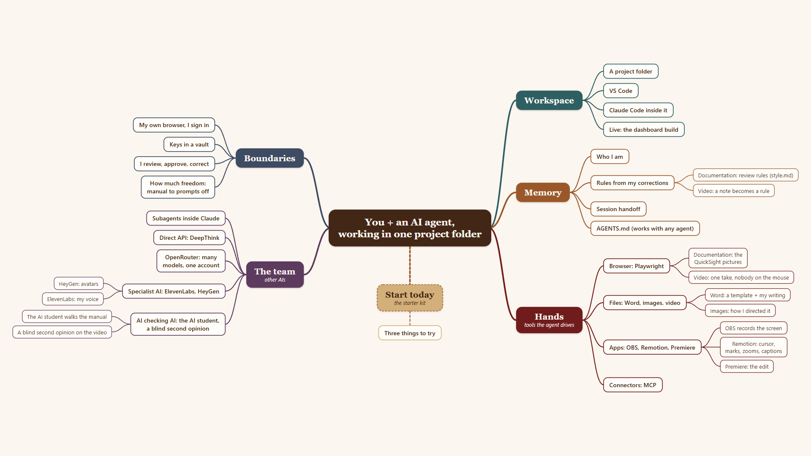

# The mind map

The five branches. The center is **you and an AI agent, working in one project folder.**

| Branch | Leaves |
|---|---|
| **Workspace** | A project folder · VS Code · Claude Code inside it · Live: the dashboard build |
| **Memory** | Who I am · Rules from my corrections · Session handoff · `AGENTS.md` (works with any agent) |
| **Hands** (tools the agent drives) | Browser: Playwright · Files: Word, images, video · Apps: OBS, Remotion, Premiere · Connectors: MCP |
| **The team** (other AIs) | Subagents inside Claude · Direct API: DeepThink · OpenRouter: many models, one account · Specialist AI: ElevenLabs, HeyGen · AI checking AI: the AI student, a blind second opinion |
| **Boundaries** | My own browser, I sign in · Keys in a vault · A person at every step you can't undo · I review, approve, correct · How much freedom: manual to prompts off |

Below the center, **Start today** (the starter kit) leads to **Three things to try**: see
[Three things to try tomorrow](../README.md#three-things-to-try-tomorrow).

Every leaf is explained in one line in [`../GLOSSARY.md`](../GLOSSARY.md), except "Live: the dashboard build", which was the demo running during the talk.
